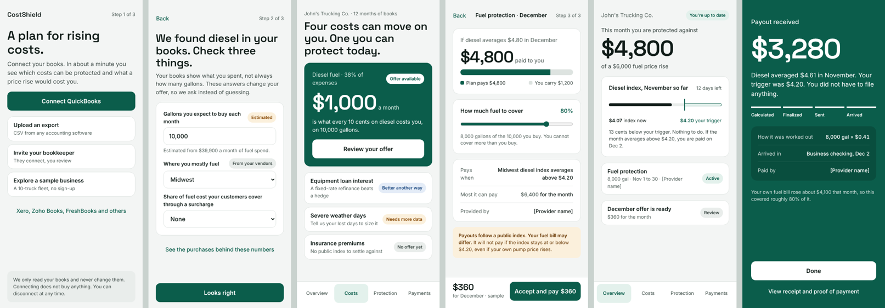
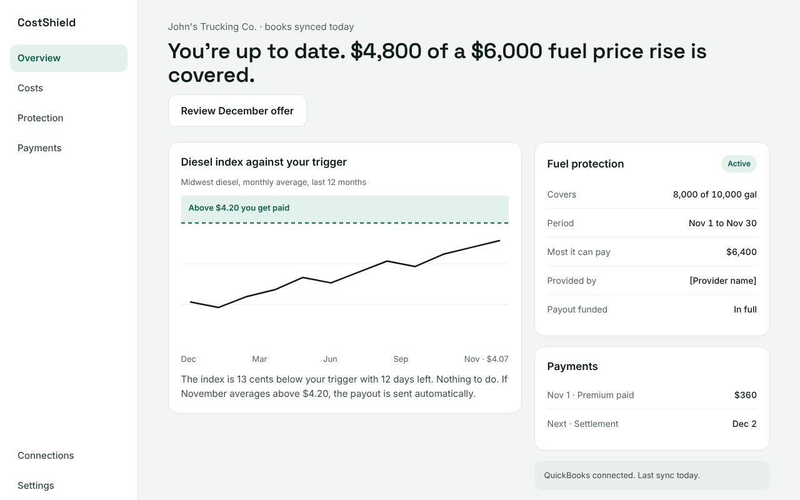
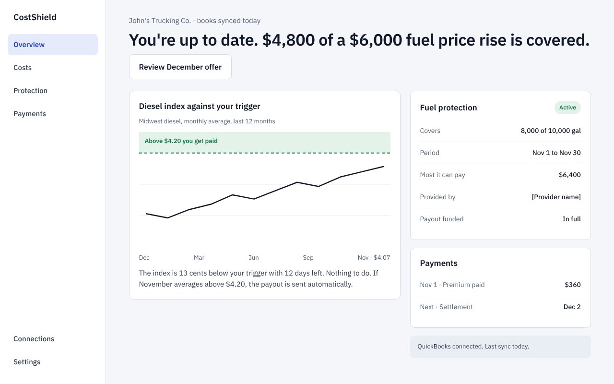
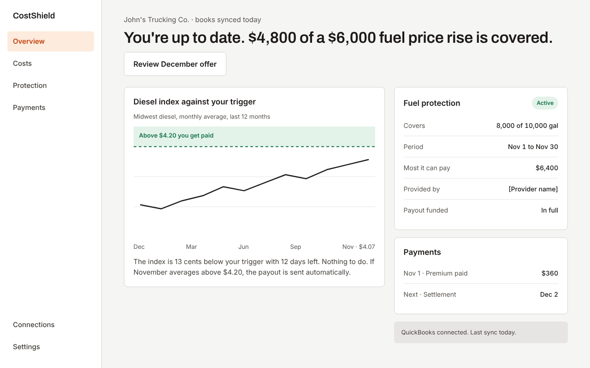
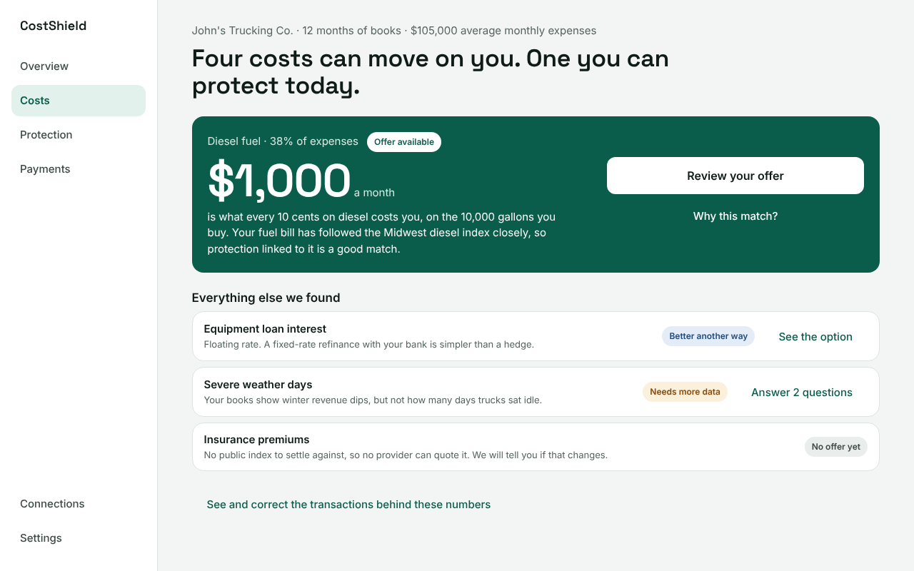
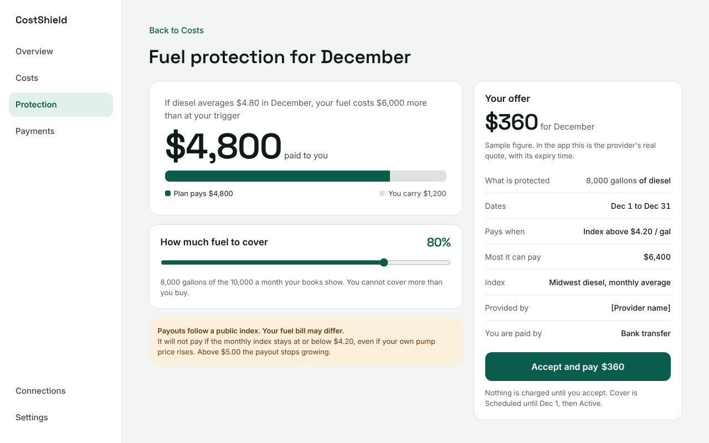
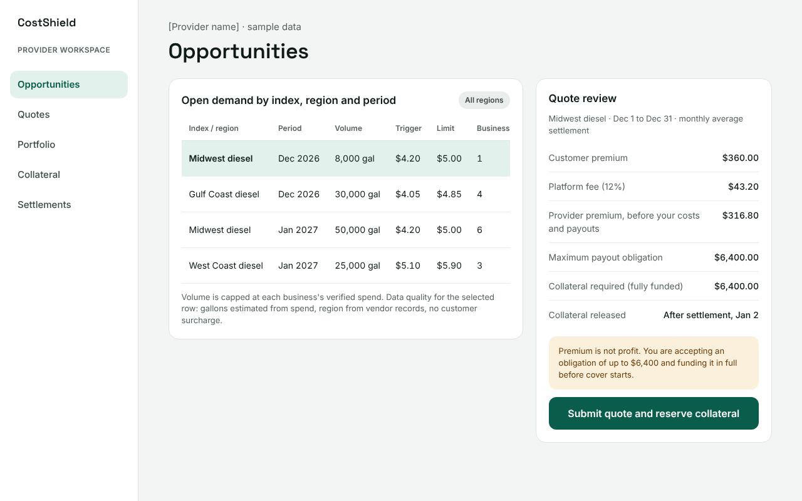

# Covenant UI/UX proposal

This folder is a design proposal, not shipped code. Nothing here is imported by the app. It exists so Aabis, Julian and any coding agent can see the intended experience, argue with it, and build from it.



## Look at it

Open `design/screens/index.html` in a browser. No build step, no install.

```bash
open design/screens/index.html          # macOS
# or, if file:// links misbehave:
npx serve design                        # then open /screens/
```

The gallery shows all ten screens and has four theme buttons. Every screen also opens on its own, and takes `?theme=evergreen|cobalt|signal|paper`. The offer screens have a working slider.

More stills are in `preview/`:

| Owner desktop, Evergreen | Same screen, Cobalt | Same screen, Signal |
| --- | --- | --- |
|  |  |  |

| Costs | Offer | Provider quote review |
| --- | --- | --- |
|  |  |  |

## What is in here

| Path | What it is |
| --- | --- |
| `screens/index.html` | Gallery of every screen with a theme switcher |
| `screens/m*.html` | Owner app on a phone: connect, confirm, costs, offer, overview, payout |
| `screens/d*.html` | Owner app on desktop: overview, costs, offer |
| `screens/p1-provider.html` | Provider workspace: opportunities and quote review |
| `tokens.css` | Colours, fonts and radii as CSS variables, four themes |
| `screens/screens.css` | The component styles the mockups share |
| `SPEC.md` | Structure, flows, states, copy rules, and how this maps onto the current app |
| `GPT_REVIEW.md` | What the GPT proposal suggested and what was adopted, changed or left out |
| `reference/gpt-proposal.md` | The GPT proposal as pasted, unedited |
| `preview/*.png` | Screenshots, so the proposal is readable on GitHub |

The concept this design serves is in `docs/CONCEPT.md`. What is actually built is in `README.md` and `docs/PRODUCT.md`.

## The proposal in five lines

1. Replace the eight-step tour (Connect, Analyze, Risks, Pool, Protection, Simulate, Payout, Onchain record) with a three-step onboarding and four permanent destinations: **Overview, Costs, Protection, Payments**.
2. One number is the hero of each screen, in dollars. Pools, fit statistics and chain details move behind "Why this match?" and the judge view.
3. Every plan shows what it will not pay for on the same screen as the price.
4. Buttons and labels say what is true right now: an estimate is not an offer, scheduled is not active, calculated is not received.
5. Providers get their own workspace. The owner app never shows collateral mechanics; the provider app never hides them.

## What is decided and what is open

Decided, unless someone objects in the PR:

- The navigation and the three-step onboarding.
- Dropping the cream background and the serif display face.
- The status words and plan states in `SPEC.md`.

Open, please weigh in:

- **Colour.** Evergreen is the default because the app's `shield` token and icon are already `#0B5D4B`, so it is the cheapest to adopt. Cobalt keeps green for "money received" only, which is a cleaner rule. Signal is the most distinct. Flip the theme buttons and pick.
- **Hero number on Costs.** This proposal uses a sensitivity ("every 10 cents costs you $1,000 a month"). The current app leads with a modelled bad-year loss.
- **Writing payouts back to the books.** Left out for now, because it contradicts "we never change your books". It could return as an explicit opt-in.

## Caveats

- Every figure is sample data for a fictional 10-truck fleet. Prices, fees and the index history are placeholders, not engine output.
- `[Provider name]` marks where the regulated risk-bearing partner appears.
- These are static mockups. Keyboard order and contrast were considered; screen-reader behaviour has to be checked in the real app.
- Screens not drawn yet: analysis progress, transaction review, review-and-sign, payments list, connections, and the rest of the provider lifecycle (quotes, portfolio, collateral, settlements).
